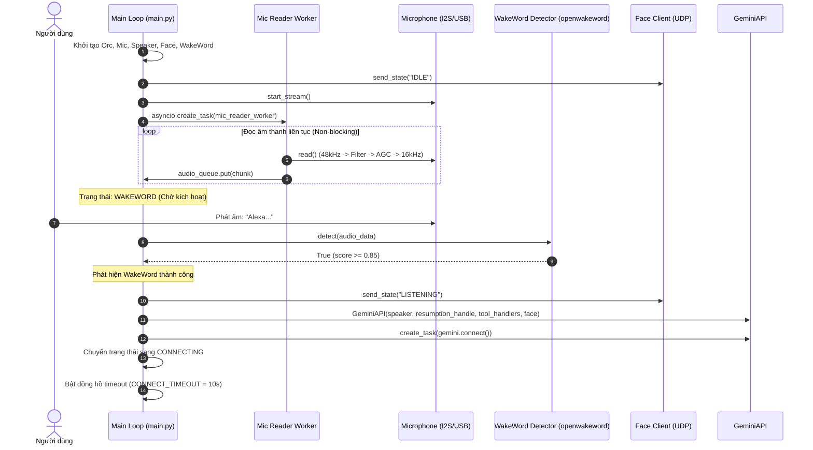
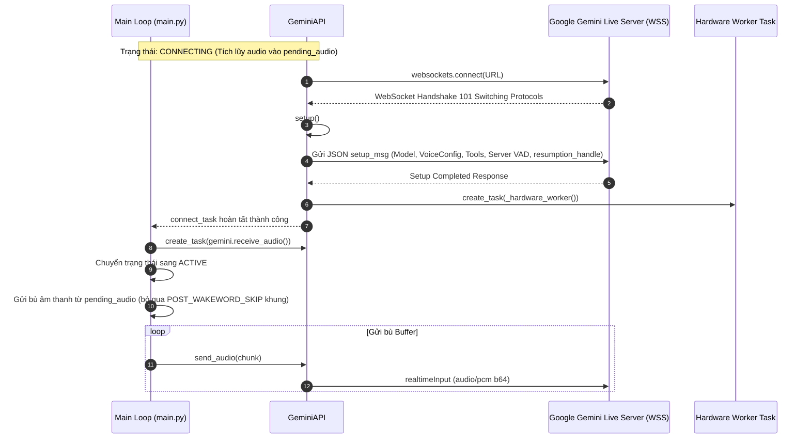
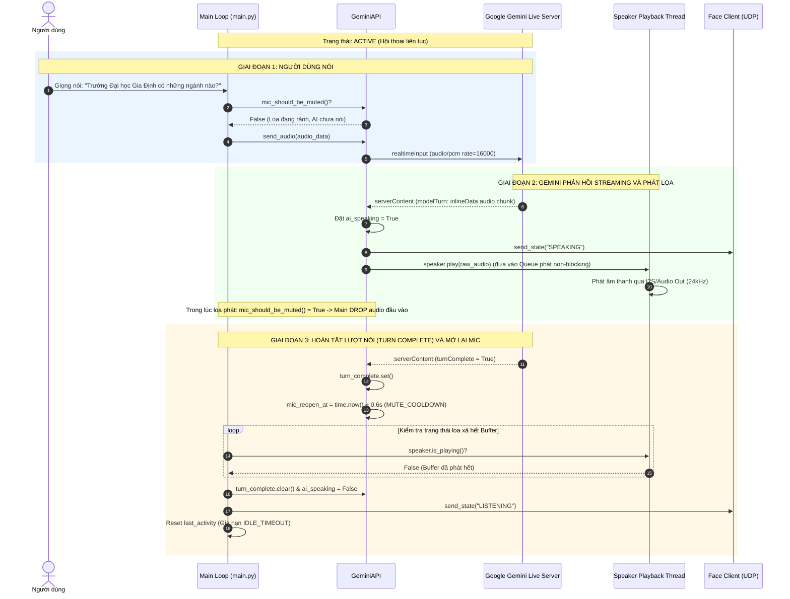
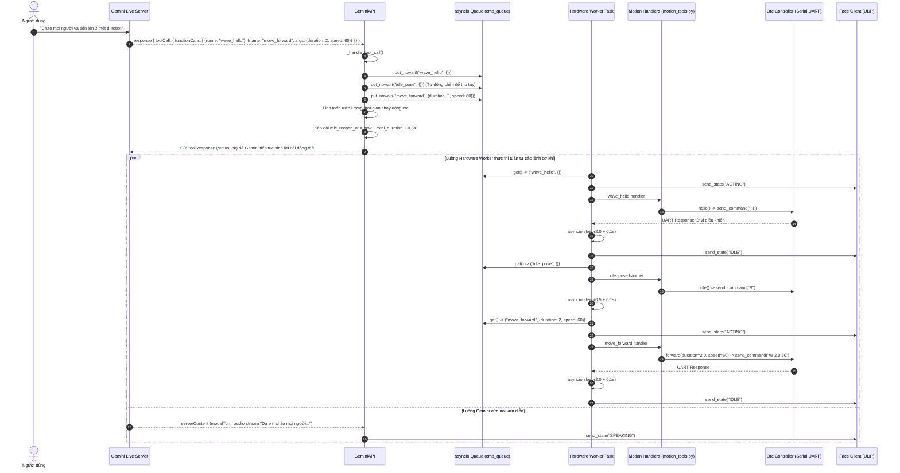
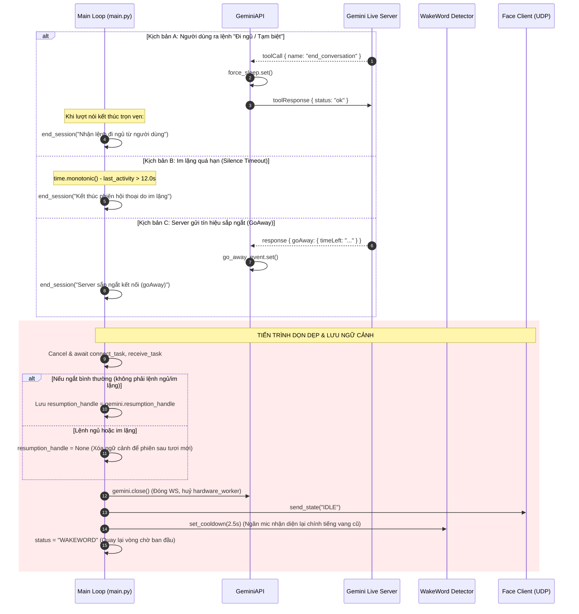
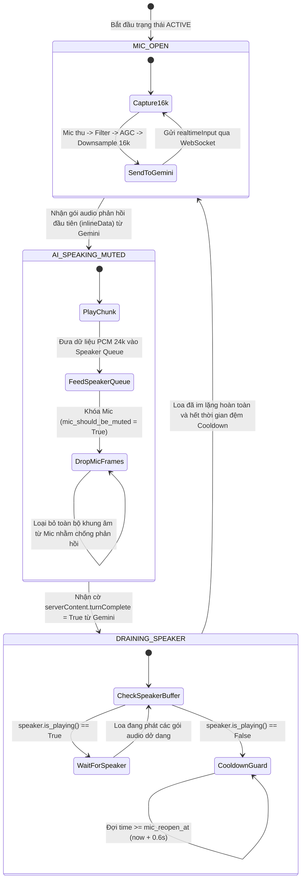
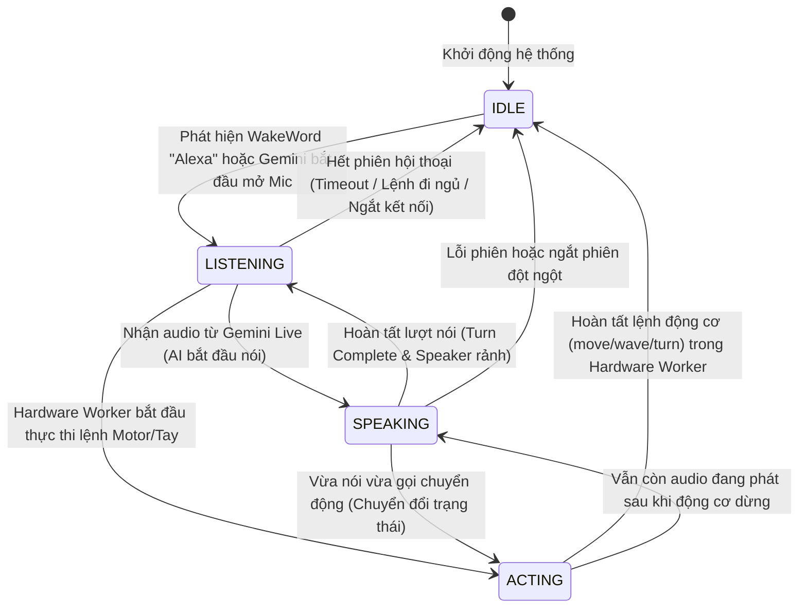

# BÁO CÁO PHÂN TÍCH THIẾT KẾ KIẾN TRÚC HỆ THỐNG ROBOT ASSISTANT (GDU)
**Tài liệu Phân Tích Luồng Hoạt Động, Sơ Đồ Tuần Tự (Sequence Diagram) và Sơ Đồ Trạng Thái (State Diagram)**

---

## 1. TỔNG QUAN HỆ THỐNG (SYSTEM OVERVIEW)

Dự án **Robot Assistant** (Trợ lý ảo robot trường Đại học Gia Định - GDU) là hệ thống nhúng thông minh tích hợp trí tuệ nhân tạo tạo sinh đa phương thức thời gian thực (Multimodal Generative AI Realtime). Hệ thống hoạt động dựa trên mô hình xử lý phân tán bất đồng bộ kết hợp giữa phần cứng biên (Raspberry Pi/Edge Device, vi điều khiển Orc Hub điều khiển động cơ) và hạ tầng điện toán đám mây (Google Gemini Live WebSocket API).

### 1.1. Các thành phần cốt lõi trong Source Code

1. **Vòng lặp điều phối trung tâm (`main.py`)**:
   - Quản trị luồng bất đồng bộ chính (`asyncio.run(main())`).
   - Quản lý máy trạng thái cấp cao: `WAKEWORD` $\rightarrow$ `CONNECTING` $\rightarrow$ `ACTIVE`.
   - Vận hành worker thu âm liên tục không nghẽn (`mic_reader_worker`) qua hàng đợi kích thước giới hạn `audio_queue(maxsize=20)`.
   - Quản lý vòng đời phiên (Session Lifecycle), timeout im lặng (`IDLE_TIMEOUT = 12.0s`), thời gian chờ kích hoạt lại wakeword (`WAKEWORD_COOLDOWN_AFTER_SESSION = 2.5s`).

2. **Module Gemini Live API (`core/gemini_api.py`)**:
   - Thiết lập kết nối hai chiều Full-duplex WebSocket (`wss://generativelanguage.googleapis.com/...`) sử dụng model `gemini-3.1-flash-live-preview`.
   - Hỗ trợ **Session Resumption** (`resumption_handle`) để ghi nhớ ngữ cảnh hội thoại xuyên suốt các lượt gọi thức dậy.
   - Cơ chế Server-side VAD (Voice Activity Detection tự động ngắt câu với độ nhạy cấu hình).
   - Cơ chế **Mic Muting Logic** (`mic_should_be_muted`, `MUTE_COOLDOWN = 0.6s`) nhằm triệt tiêu hiện tượng dội âm (Acoustic Echo Feedback) khi loa đang phát câu trả lời của AI.
   - Hàng đợi bất đồng bộ điều khiển phần cứng riêng biệt (`cmd_queue` và task `_hardware_worker`) giúp tách rời thời gian thực thi của động cơ ra khỏi luồng xử lý audio/network.

3. **Module Điều khiển Chuyển động & Phần cứng (`controller/orc_controller.py` & `controller/motion_tools.py`)**:
   - Giao tiếp nối tiếp UART/Serial (`/dev/ttyACM0`, 115200 baud) với vi điều khiển Orc Hub.
   - Điều khiển chuyển động (`W`: Tiến, `S`: Lùi, `Q`: Xoay trái, `E`: Xoay phải, `X`: Dừng, `H`: Vẫy tay, `B`: Tư thế nghỉ).
   - Cơ chế Thread-safe Serial với `threading.Lock()` bảo vệ dữ liệu truyền nhận.
   - Ánh xạ Function Calling (Tool Declarations) từ Gemini Live: `move_forward`, `move_backward`, `turn_left`, `turn_right`, `stop_robot`, `wave_hello`, `idle_pose`, `end_conversation`.

4. **Module Hiển thị Biểu cảm (`display/face_client.py`)**:
   - Giao tiếp phi khóa (Non-blocking UDP Socket) gửi gói tin trạng thái biểu cảm tới màn hình (`gdupi3.local:5005`).
   - Phân giải sẵn địa chỉ IP (`_resolve_ip`) tránh nghẽn luồng xử lý do DNS lookup.
   - 4 trạng thái biểu cảm: `IDLE` (Chờ/Nghỉ), `LISTENING` (Đang nghe), `SPEAKING` (Đang nói), `ACTING` (Đang vận động).

5. **Module Âm thanh & Nhận diện WakeWord (`audio/`, `wakeword/`)**:
   - **Microphone (`audio/microphone.py`)**: Thu âm 48kHz Stereo 32-bit, bộ lọc High-pass (40Hz cắt ù DC), SoftAGC (tự động điều biến độ lợi mượt mà chống méo âm), Low-pass chống gấp dải phổ (anti-aliasing) và Downsample về 16kHz Mono 16-bit PCM.
   - **Speaker (`audio/speaker.py`)**: Phát âm thanh 24kHz 16-bit PCM với hàng đợi non-blocking thread-safe `queue.Queue(maxsize=150)` và luồng playback riêng biệt; hỗ trợ `flush()` tức thì khi bị gián đoạn.
   - **WakeWordDetector (`wakeword/detector.py`)**: Sử dụng mô hình `openwakeword` nhận diện từ khóa "Alexa" cục bộ với ngưỡng tin cậy $0.85$ và cơ chế Cooldown chống kích hoạt trùng lặp.

---

## 2. THIẾT KẾ SƠ ĐỒ TUẦN TỰ (SEQUENCE DIAGRAMS)

### 2.1. Sơ đồ 1: Khởi động hệ thống và Kích hoạt WakeWord ("Alexa")

---

### 2.2. Sơ đồ 2: Kết nối WebSocket Gemini Live & Thiết lập Phiên (Bắt tay & Session Resumption)

---

### 2.3. Sơ đồ 3: Giao tiếp Thoại hai chiều Full-Duplex & Quản lý Chống dội âm (Mute Logic)

---

### 2.4. Sơ đồ 4: Thực thi Gọi Hàm Phần Cứng (Function Calling / Tool Execution)

---

### 2.5. Sơ đồ 5: Luồng Kết Thúc Phiên Hội Thoại (Session Teardown)

---

## 3. THIẾT KẾ SƠ ĐỒ TRẠNG THÁI (STATE DIAGRAMS)

### 3.1. Sơ đồ Trạng thái Tổng thể Hệ thống (System High-Level FSM)

Máy trạng thái của chương trình chính (`main.py`) điều khiển toàn bộ chu kỳ sống từ lúc khởi động cho tới khi chạy hội thoại và dọn dẹp.

```mermaid
stateDiagram-v2
    [*] --> SYSTEM_INIT: Khởi chạy main()

    state SYSTEM_INIT {
        [*] --> InitHardware
        InitHardware --> InitAudio: Kết nối Orc Serial (/dev/ttyACM0)
        InitAudio --> StartMicWorker: Mở luồng PyAudio (Mic + Speaker)
        StartMicWorker --> [*]: Tạo mic_reader_worker (Queue 20)
    }

    SYSTEM_INIT --> WAKEWORD: Hoàn tất khởi tạo (status = "WAKEWORD")

    state WAKEWORD {
        [*] --> CheckCooldown
        CheckCooldown --> SleepWait: is_in_cooldown() == True
        SleepWait --> CheckCooldown: Chờ hết cooldown (2.5s)
        CheckCooldown --> Detecting: is_in_cooldown() == False
        Detecting --> Detecting: score < 0.85 (Tiếp tục nghe)
    }

    WAKEWORD --> CONNECTING: WakeWord "Alexa" phát hiện (score >= 0.85) / Face = "LISTENING"

    state CONNECTING {
        [*] --> OpenWebSocket
        OpenWebSocket --> SendSetup: WS Connected
        SendSetup --> WaitResponse: Gửi setup_msg (tools, voice, resumption)
        WaitResponse --> BufferAudio: Lắng nghe âm thanh đầu vào đưa vào pending_audio
        BufferAudio --> Ready: Nhận Setup Completed
    }

    CONNECTING --> WAKEWORD: Timeout kết nối (>10s) hoặc Lỗi WS / end_session()
    CONNECTING --> ACTIVE: Kết nối & Setup thành công / Tạo receive_audio task

    state ACTIVE {
        [*] --> DuplexConversation
        state DuplexConversation {
            state "USER_SPEAKING / STREAMING" as UserSpeak
            state "GEMINI_THINKING / ACTING" as AiThink
            state "AI_SPEAKING" as AiSpeak
            state "TURN_COMPLETE_DRAIN" as TurnDrain

            [*] --> UserSpeak
            UserSpeak --> AiThink: Gemini Server VAD kích hoạt ngắt câu
            AiThink --> AiSpeak: Nhận inlineData PCM
            AiSpeak --> TurnDrain: serverContent.turnComplete == True
            TurnDrain --> UserSpeak: Loa xả hết buffer & Hết MUTE_COOLDOWN (0.6s)
        }
    }

    ACTIVE --> WAKEWORD: IDLE_TIMEOUT (12s) / "end_conversation" / Server GoAway / Gặp lỗi
    
    WAKEWORD --> SHUTDOWN: Nhận tín hiệu KeyboardInterrupt (Ctrl+C)
    CONNECTING --> SHUTDOWN: Nhận tín hiệu KeyboardInterrupt
    ACTIVE --> SHUTDOWN: Nhận tín hiệu KeyboardInterrupt

    state SHUTDOWN {
        [*] --> CancelTasks
        CancelTasks --> CloseGemini: Hủy mic_task, receive_task, connect_task
        CloseGemini --> DisconnectHardware: Đóng WS
        DisconnectHardware --> [*]: Ngắt Orc Serial, Tắt Face UDP, Đóng Loa & Mic
    }

    SHUTDOWN --> [*]
```

---

### 3.2. Sơ đồ Trạng thái Chi tiết: Vòng lặp Âm thanh & Triệt tiêu Dội âm (Audio & Acoustic Echo Muting State Machine)

Logic điều khiển Micro trong `core/gemini_api.py` và `main.py` là hạt nhân quyết định khả năng đàm thoại tự nhiên mượt mà mà không bị tiếng loa phản hồi vào mic.

---

### 3.3. Sơ đồ Trạng thái Màn hình Biểu cảm Robot (Face Display State Machine)

Module `FaceClient` liên tục phát tín hiệu trạng thái tới Raspberry Pi qua UDP Socket để hiển thị khuôn mặt động:

---

## 4. BẢNG MA TRẬN CHUYỂN TRẠNG THÁI CHI TIẾT (STATE TRANSITION TABLE)

| STT | Trạng thái hiện tại | Sự kiện kích hoạt (Event / Trigger) | Điều kiện biên (Guard Condition) | Hành động thực hiện (Actions) | Trạng thái tiếp theo |
|:---:|:---|:---|:---|:---|:---|
| **1** | `SYSTEM_INIT` | Ứng dụng khởi động | Cổng Serial mở thành công hoặc bỏ qua lỗi | Khởi tạo Microphone, Speaker, Orc, FaceClient, WakeWord. Bật luồng đọc Mic ngầm. | `WAKEWORD` |
| **2** | `WAKEWORD` | Âm thanh từ Mic đổ về hàng đợi | `wakeword.is_in_cooldown() == True` | Bỏ qua khung âm, không chạy model nhằm tiết kiệm CPU và tránh kích hoạt nhầm. | `WAKEWORD` |
| **3** | `WAKEWORD` | Đọc âm thanh | `wakeword.detect(chunk) == True` (Score $\ge 0.85$) | Đổi Face sang `"LISTENING"`, tạo `GeminiAPI`, khởi tạo `gemini.connect()` task, đặt deadline timeout 10s. | `CONNECTING` |
| **4** | `CONNECTING` | Âm thanh đổ về liên tục | Đang đợi handshake | Tích lũy âm thanh vào danh sách tạm `pending_audio`. | `CONNECTING` |
| **5** | `CONNECTING` | `time.monotonic() > connect_deadline` | Quá 10s không nhận phản hồi từ Gemini | Báo lỗi `TimeoutError`, dọn dẹp kết nối, đặt Face `"IDLE"`. | `WAKEWORD` |
| **6** | `CONNECTING` | `connect_task.done()` | Không có Exception | Tạo task `receive_audio`, chuyển Face `"LISTENING"`, gửi bù âm thanh đã buffer (bỏ 2 frame đầu). | `ACTIVE` |
| **7** | `ACTIVE` | Người dùng nói vào Mic | `mic_should_be_muted() == False` | Mã hóa Base64 PCM 16kHz, gửi bản tin `realtimeInput` qua WebSocket. | `ACTIVE` |
| **8** | `ACTIVE` | Nhận phản hồi `inlineData` | `serverContent.modelTurn` có audio | Đặt `ai_speaking = True`, đổi Face `"SPEAKING"`, đưa dữ liệu thô vào `speaker.play()`. | `ACTIVE` |
| **9** | `ACTIVE` | Loa đang phát hoặc `ai_speaking == True` | `mic_should_be_muted()` được gọi | Trả về `True`, tính lại mốc `mic_reopen_at = now + 0.6s`, chặn không gửi Mic lên Gemini. | `ACTIVE` |
| **10** | `ACTIVE` | Nhận `toolCall` từ Gemini | Hàm có trong `tool_handlers` | Đẩy `(name, args)` vào `cmd_queue`, ước lượng thời gian chạy động cơ, phản hồi ngay `toolResponse` (status: ok). | `ACTIVE` |
| **11** | `ACTIVE` | `cmd_queue` có phần tử | `_hardware_worker` đang chạy | Đổi Face `"ACTING"`, chạy hàm điều khiển Orc Serial trong thread pool, sau đó đổi lại Face `"IDLE"`. | `ACTIVE` |
| **12** | `ACTIVE` | Nhận `serverContent.turnComplete` | Server báo kết thúc câu trả lời | Đặt cờ `turn_complete.set()`, gia hạn thời gian bảo vệ chống dội âm `mic_reopen_at`. | `ACTIVE` |
| **13** | `ACTIVE` | Loa phát xong (`is_playing() == False`) | `time.monotonic() >= gemini.mic_reopen_at` | Xóa cờ `turn_complete`, đặt `ai_speaking = False`, đổi Face `"LISTENING"`, cập nhật `last_activity`. | `ACTIVE` |
| **14** | `ACTIVE` | Nhận tool `end_conversation` | Người dùng nói chào tạm biệt/đi ngủ | Đặt `force_sleep.set()`, đợi nói xong câu chào rồi gọi `end_session("Nhận lệnh đi ngủ")`. | `WAKEWORD` |
| **15** | `ACTIVE` | `time.monotonic() - last_activity > 12.0s` | Không có tương tác âm thanh từ cả 2 phía | Gọi `end_session("Kết thúc phiên do im lặng")`, xóa `resumption_handle`. | `WAKEWORD` |
| **16** | `ACTIVE` | Nhận bản tin `goAway` | Server chuẩn bị ngắt WebSocket | Đọc `timeLeft`, gọi `end_session("Server sắp ngắt")`. | `WAKEWORD` |
| **17** | `ACTIVE` | Đứt cáp mạng / WebSocket Error | `receive_task.exception()` khác `None` | Bắt ngoại lệ, gọi `end_session("Lỗi trong phiên")`, chờ 1.0s. | `WAKEWORD` |
| **18** | `BẤT KỲ` | Người dùng nhấn Ctrl+C | `KeyboardInterrupt` | Hủy toàn bộ Task nền, đóng Serial Orc Hub, giải phóng PyAudio Mic/Speaker, tắt Socket UDP. | `TERMINATED` |

---

## 5. CÁC ĐIỂM SÁNG KIẾN VÀ KỸ THUẬT TỐI ƯU TRONG SOURCE CODE

1. **Pipeline xử lý âm thanh số hóa chất lượng cao (DSP Audio Pipeline)**:
   - Thay vì thu âm trực tiếp ở 16kHz dễ bị méo hài trên phần cứng Raspberry Pi, hệ thống thu ở tần số tiêu chuẩn **48kHz Stereo 32-bit**, lọc thông cao 40Hz loại bỏ tạp âm rung sàn và DC offset, áp dụng thuật toán nén dải động **SoftAGC** thích ứng nhanh (`attack=0.7`, `release=0.98`), sau đó lọc chống gấp tần (Anti-aliasing Lowpass) rồi mới Downsample về **16kHz Mono 16-bit**.
2. **Kiến trúc Producer-Consumer cách ly hoàn toàn IO phần cứng**:
   - `mic_reader_worker` sử dụng `run_in_executor` để việc đọc phần cứng PyAudio không chặn Event Loop của asyncio. Hàng đợi có cơ chế tự drop frame cũ khi đầy (`Queue.full()`), đảm bảo độ trễ âm thanh luôn ở mức thời gian thực (< 50ms).
   - Tương tự, `_hardware_worker` tách các lệnh động cơ có độ trễ lớn (chạy 1-2 giây) vào hàng đợi riêng, cho phép mô hình AI vừa nói vừa ra lệnh mà không làm nghẽn luồng xử lý WebSocket.
3. **Cơ chế chống Acoustic Echo Feedback tự trị (Zero-Cost AEC)**:
   - Không cần dùng bộ AEC phức tạp tốn tài nguyên phần cứng, hệ thống phối hợp giữa kiểm tra trạng thái bộ đệm loa (`speaker.is_playing()`) và thời gian hạ nhiệt Cooldown (`MUTE_COOLDOWN = 0.6s`), triệt tiêu triệt để tình trạng AI tự nghe thấy giọng của chính mình rồi ngắt lời giữa chừng.
4. **Quản lý ngữ cảnh thông minh (Smart Context Persistence)**:
   - Hệ thống biết phân biệt lý do kết thúc phiên: Nếu kết thúc vì "đi ngủ" hoặc "im lặng quá lâu", `resumption_handle` sẽ bị xóa để phiên tiếp theo mở đầu mới mẻ. Nếu kết thúc do ngắt kết nối kỹ thuật, handle được lưu lại để duy trì trí nhớ của cuộc trò chuyện.

---

## 6. KẾT LUẬN

Hệ thống mã nguồn của **Robot Assistant** được thiết kế mạch lạc theo mô hình **Sự kiện - Bất đồng bộ (Event-driven Asynchronous Architecture)**. Việc kết hợp chặt chẽ giữa các máy trạng thái cấp ứng dụng và máy trạng thái xử lý tín hiệu âm thanh giúp robot vận hành ổn định, độ trễ thấp và đem lại trải nghiệm tương tác tự nhiên.
